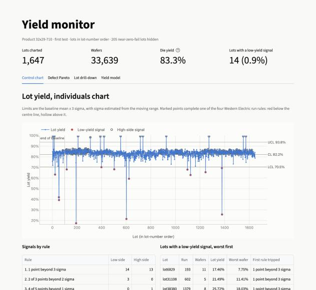

# 良率监控看板 (yield-dashboard)

[](https://github.com/litaoshu0727-del/yield-dashboard/actions/workflows/tests.yml)

**一句话**:把 81 万片真实晶圆的测试数据存进 SQLite,用 SPC 控制图监控每个产品的批次良率,报警批次可以一路下钻到单片晶圆图。

| 做了什么 | 结果 |
|---|---|
| SQLite 存储 + SQL 汇总 + Streamlit 界面 | 154 个产品、81 万片晶圆,看板只读数据库 |
| 三种控制图:单值图(Western Electric 规则)、EWMA、CUSUM | 模拟 1σ 的持续偏移:单值图 35 批后报警,EWMA 和 CUSUM 9 批 |
| 在批次最多的产品上监控 1,647 批 | 14 个低良率报警,全部是单批事件,没有持续性的良率下移 |
| 排查控制图上良率交替跳变的原因 | 发现约 26% 的批次是同一批晶圆的重复或复测记录,分离后控制图恢复正常 |
| 接入晶圆图分类项目训练的 CNN | 主力产品有缺陷图案信息的晶圆从 287 片增至 1,198 片 |
| 拟合四个经典良率模型 | 跨产品缺陷密度 D0 约 0.17–0.25 个/cm² |



## 看板有什么

| 页面 | 内容 |
|---|---|
| Control chart | 三种控制图可切换:单值图(Western Electric 四条判异规则)、EWMA、CUSUM(列出检测到的偏移段及其起止批次);下方是边缘 die 和内部 die 的失效率对比 |
| Defect Pareto | 按缺陷模式统计失效 die,可切换"工程师标注"和"分类器预测"(可调置信度门槛) |
| Lot drill-down | 选一个批次,看它每片晶圆的 bin map,以及分类器给出的缺陷模式和置信度 |
| Yield model | 各产品的良率对 die 面积作图,拟合 Poisson、Murphy、Seeds、负二项四个良率模型,给出缺陷密度 D0 |

界面文字是英文,用的是行业通用术语。

## 快速开始

```bash
pip install -e ".[dev]"
python -m yielddash.etl --synthetic --db data/demo.db    # 不需要数据集的演示库
pytest                                                   # 29 项测试,最后一项在演示库上把看板跑一遍
streamlit run app.py
```

用真实数据(WM-811K 的 `LSWMD.pkl`,约 2 GB):

```bash
python -m yielddash.etl --source path/to/LSWMD.pkl --db data/yield.db
```

建库约 40 秒,生成的数据库约 270 MB。

可选:用 [wafer-map-yield](https://github.com/litaoshu0727-del/wafer-map-yield) 项目训练好的 CNN 给每片晶圆打上缺陷模式(需要 PyTorch,81 万片在 CPU 上约 7 分钟):

```bash
pip install -e ".[classify]"
# 在 wafer-map-yield 里导出模型
python -m wafermap.export --run reports/wm811k_seeds/cnn_w0.5_s0 --out ../yield-dashboard/models/wafer_cnn
# 回到这里打分,结果写进数据库的 predictions 表
python -m yielddash.classify --db data/yield.db --model models/wafer_cnn.pt2
```

看板本身不需要 PyTorch,只读 `predictions` 表;没有这张表时,相关的列和选项不会出现。

## 数据是怎么组织的

三张表:`products`、`wafers`(每片晶圆一行,bin map 压缩后存成 BLOB)、`lot_yield`(批次汇总,建库时算好)。看板里所有汇总都是 SQL 写的,在 `yielddash/queries.py`,用到了窗口函数(移动平均、累计占比)。看板以只读方式打开数据库。

WM-811K 没有产品名和时间戳,所以做了两个约定:

- **产品**用晶圆图的网格尺寸加 die 数来区分,例如 `32x29-710`。不同产品的良率水平不同,必须分开监控。
- **时间顺序**用批次号代替。

## 一个数据问题:同一批晶圆被记录了多次

第一次把所有批次画到控制图上时,良率在相邻批次之间来回跳(约 83% 和约 99.9% 交替),控制限宽到没有意义。逐片对比晶圆图后发现,**连续的批次号经常是同一批晶圆在后续测试步骤的再次记录**:slot 相同、die 位置完全一致,只是失效图有规律地相关。数据集文档没有说明这一点,以下是根据晶圆图做的推断。

建库时把每个批次和它前一个批次号对比,分成三类:

| 类别 | 判定 | 批次数 | 晶圆数 |
|---|---|---|---|
| `first` 首次测试 | 和前一个批次没有下面两种关系 | 34,344 | 623,945 |
| `repeat` 重复记录 | 失效图几乎和前一批相同,通常只多几个失效,像是同一批晶圆的累计结果 | 3,997 | 65,159 |
| `retest` 复测记录 | 失效数不到前一批的 20%,并且要么全都不在已失效的 die 上,要么全都在 | 7,952 | 122,345 |

看板默认只用首次测试的记录来监控,另外两类可以在侧栏切换查看。

另外还有一部分近乎零失效的批次,和相邻批次对不上关系,但它们的良率自成一簇(99.5% 以上),和正常批次之间是空的。106 个批次数足够的产品里有 6 个存在这种情况,共 504 个批次。侧栏有一个默认勾选的选项把它们隐藏,可以取消。良率本来就很高的产品不会被这个选项影响。

## 真实数据上的结果

以批次最多的产品 `32x29-710` 为例(首次测试,每批至少 5 片晶圆,隐藏 205 个近零失效批次后剩 1,647 批):

- 用前 100 批做基线:中心线 82.2%,σ 为 3.9 个百分点,控制限 70.5%–93.8%。
- 14 个批次(0.9%)触发低良率报警,全部是规则 1(超出 3σ),最差的一批良率只有 17.5%。
- 444 个批次触发高侧信号,其中 434 个是规则 4(连续 8 点在中心线同一侧):基线之后良率整体高于基线水平。这种信号不是报警,图上用空心点和报警区分。
- 这个产品边缘 die 的失效率(约 20%–30%)一直是内部 die(约 10%–15%)的两倍左右。

EWMA 和 CUSUM(同一基线、同一 σ):

- 截断前,CUSUM 报出 4 段"良率下移",EWMA 有 24 批低于下限。逐段检查发现它们都是单个报废级批次(z 低到 −16)触发的:一个点就把累计和推过阈值,之后要几十批才回到零,而这些段内的良率中位数是 82%–85%,并不低于中心线。
- 把每批的 z 值截断到 ±3 后,两种图都没有低侧信号:这个产品**没有持续的良率下移**,低良率问题全是单批事件,由单值图的规则 1 负责。
- CUSUM 高侧找到 4 段持续上移,良率约 84%–86%,比基线高约 2 个点。第一段从第 96 批开始,到第 309 批前后结束。这和单值图上大量规则 4(连续 8 点在中心线上方)的高侧信号是同一件事,而 CUSUM 能给出起止批次。

良率模型(154 个首次测试批次数不少于 50 的产品,假设 300 mm 晶圆):

| 模型 | D0(个/cm²) | 聚集因子 α | 拟合误差(良率点) |
|---|---|---|---|
| Poisson | 0.168 | – | 0.078 |
| Murphy | 0.171 | – | 0.078 |
| Seeds | 0.185 | – | 0.078 |
| 负二项 | 0.250 | 0.23 | 0.077 |

四个模型的拟合误差几乎一样,数据分不出哪个更好。

## 用分类器补上缺失的缺陷标注

工程师只标注了很少一部分晶圆:批次最多的产品 `32x29-710` 有 38,345 片首测晶圆,只有 287 片带标注。所以原来的缺陷 Pareto 只描述了不到 1% 的晶圆,批次下钻页也大多没有图案信息。

接入的是 [wafer-map-yield](https://github.com/litaoshu0727-del/wafer-map-yield) 项目的 CNN(5 个种子的测试集 macro-F1 0.854 ± 0.005),导出成独立的 `.pt2` 文件后离线打分,每片晶圆存一个最可能的类别和它的概率。看板里默认只采用置信度 ≥ 0.9 的预测,低于这个值的相当于交给人工复判。

在 `32x29-710` 上:

- 置信度 ≥ 0.9 的有 27,839 片(73%),其中 1,198 片被判为有缺陷图案,是人工标注量的 4 倍。
- 按预测统计的 Pareto 和按标注统计的不一样:Edge-Loc 都排第一(44% 对 60%),但 Random 从 12% 升到 32%。人工挑出来标注的晶圆并不代表整体。
- 14 个低良率报警批次都能给出主要缺陷模式,其中 10 个是 Random 或 Near-full,也就是整片晶圆大面积失效,而不是某个局部的工艺特征。

需要注意的地方:

- 在带标注的测试集上,约 90% 的晶圆置信度超过 0.88;而在全部首测晶圆上,置信度 ≥ 0.9 的只有 62%。没标注的晶圆和标注过的分布不同,模型在它们上面的准确率很可能低于测试集上的数字。
- 模型只用首测记录训练。在复测记录(大部分 die 已在上一步被剔除)上,置信度 ≥ 0.9 的只有 13%,所以复测记录的预测基本都会落到门槛以下,不会被误用。
- 带标注的晶圆里有一部分就是模型的训练数据,所以看板里不显示"模型和标注的一致率",那个数字会偏高。模型的准确率以 `wafer-map-yield` 里按 lot 划分的测试集为准。

## 三种控制图分别管什么

| 图 | 擅长 | 1σ 下移后的报警延迟(中位数) | 100 批正常数据里误报的比例 |
|---|---|---|---|
| 单值图 + 规则 1 | 单个严重偏离的批次 | 35 批 | 15% |
| EWMA(λ = 0.2, L = 3) | 小幅、持续的偏移 | 9 批 | 10% |
| CUSUM(k = 0.5, h = 5) | 小幅、持续的偏移,并能估计偏移起点 | 9 批 | 10% |

模拟设置:正态噪声,前 100 批做基线,第 200 批起均值下移 1σ,重复 200 次,只统计低侧报警。

批次良率的分布有很重的低尾(偶尔整批报废),所以 EWMA 和 CUSUM 在计算前把每批截断到中心线 ±3σ:单批事件交给单值图,EWMA 和 CUSUM 只回答"良率水平有没有移动"。CUSUM 的偏移起点取累计和最后一次离开零的批次,终点取累计和的峰值处:大偏移结束后,累计和要很多批才能降回零,用回零的位置会高估偏移的持续时间。

## 为什么用单值控制图而不是 p 图

批次良率的波动远大于二项分布的预期(不同批次的缺陷水平本身就不一样),按 p 图算出的控制限会窄到几乎每批都报警。所以这里把批次良率当作单个测量值,σ 用相邻批次的移动极差估计。用移动极差而不用整体标准差,是因为良率一旦发生偏移或漂移,整体标准差会被撑大,反而把偏移藏起来。

## 局限

- 重复记录和复测的判定是从晶圆图推断的,阈值(80% 共同 slot、90% 包含、20% 失效数)是我定的,没有官方依据。不过结论对阈值不敏感:在 `wafer-map-yield` 项目里把四个阈值各扫了一遍,被判为重复或复测的批次数变动不超过 3%(见该项目的[数据质量分析](https://github.com/litaoshu0727-del/wafer-map-yield/blob/main/docs/data-quality.md))。
- 晶圆直径是假设的,只影响 die 面积和 D0 的绝对数值。
- 良率模型是跨产品拟合的,而不同产品的工艺和成熟度不同,所以它只是粗略描述。产品列表和这一页的产品良率没有扣除上面说的近零失效批次。
- 同一批次里如果晶圆的 die 数不同,会被拆到不同产品下。
- 缺陷模式的标注很不均匀:`32x29-710` 的 38,345 片里只有 287 片有标注。

## 目录

| 文件 | 作用 |
|---|---|
| `app.py` | Streamlit 看板 |
| `yielddash/etl.py` | 建库:识别重复记录、压缩晶圆图、生成批次汇总 |
| `yielddash/queries.py` | 看板用到的全部 SQL |
| `yielddash/spc.py` | 控制限、Western Electric 判异规则、EWMA、CUSUM 和偏移段 |
| `yielddash/yieldmodel.py` | 四个良率模型、拟合、反推 D0 |
| `yielddash/classify.py` | 用导出的 CNN 给所有晶圆打分,写入 predictions 表(唯一需要 PyTorch 的部分) |
| `yielddash/wm811k.py` | 读取 WM-811K 的旧格式文件 |
| `yielddash/synthetic.py` | 带已知事件的合成数据(良率阶跃、缓慢漂移、重复记录) |

## 数据来源

用的是公开的 WM-811K 数据集,不包含在仓库里(获取方式见 [wafer-map-yield 的数据来源](https://github.com/litaoshu0727-del/wafer-map-yield#数据来源))。出处:

M.-J. Wu, J.-S. R. Jang, J.-L. Chen, "Wafer Map Failure Pattern Recognition and Similarity Ranking for Large-Scale Data Sets," *IEEE Transactions on Semiconductor Manufacturing*, vol. 28, no. 1, pp. 1–12, 2015. [doi:10.1109/TSM.2014.2364237](https://doi.org/10.1109/TSM.2014.2364237)

## 相关项目

- [wafer-map-yield](https://github.com/litaoshu0727-del/wafer-map-yield):晶圆图良率分析和缺陷图案分类,看板里的 CNN 来自这里
- [secom-root-cause](https://github.com/litaoshu0727-del/secom-root-cause):SECOM 产线数据的根因候选筛查

## 许可

代码使用 MIT 许可,见 [LICENSE](LICENSE)。数据集的使用请遵守其条款并引用原始论文。
